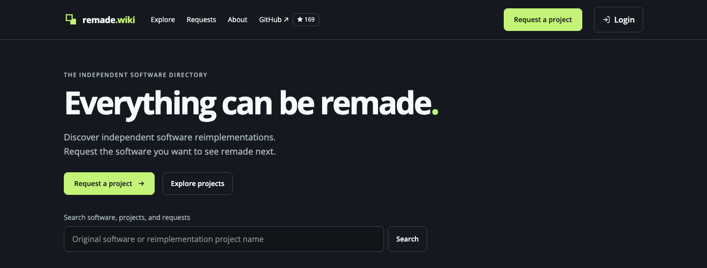

<p align="center">
  <a href="https://remade.wiki">
    
  </a>
</p>

<h1 align="center">Remade.wiki</h1>

<p align="center"><strong>Everything can be remade.</strong></p>

<p align="center">
  A community-maintained directory of independently developed,<br />
  open-source software reimplementations.
</p>

<p align="center">
  <a href="https://remade.wiki/explore/"><strong>Explore projects</strong></a> ·
  <a href="https://remade.wiki/requests/">Project requests</a> ·
  <a href="CONTRIBUTING.md">Contribute</a> ·
  <a href="POLICY.md">Submission policy</a>
</p>

[](https://remade.wiki)

## Find your next project

- **Explore reimplementations** by the software they replace, category, platform, or language.
- **Check compatibility and limitations** before trying a project. Each listing links to its source and documentation.
- **Request what's missing** and discover the software people want to see remade next.

Remade is a directory. Listed projects are developed and maintained by their own authors.

## Help grow the catalog

| Have something to share? | Start here |
| --- | --- |
| Found an existing reimplementation | [Suggest a project](https://github.com/replicraft/remade/issues/new?template=catalog-suggestion.yml) |
| Want software that hasn't been remade yet | [Request a project](https://github.com/replicraft/remade/issues/new?template=project-request.yml) |
| Ready to add or correct a listing | [Open a pull request](CONTRIBUTING.md) |

Submissions are reviewed by maintainers. Merged catalog pull requests appear in the directory. Suggestions receive automated link, duplicate, and repository checks; maintainers decide what to publish.

<details open>
<summary><strong>Add a listing with a pull request</strong></summary>

1. Read the [submission policy](POLICY.md) and [contribution guide](CONTRIBUTING.md).
2. Check `apps/frontend/remade-wiki/src/content/catalog/projects/` to make sure the project isn't already listed.
3. Fork this repository and add `apps/frontend/remade-wiki/src/content/catalog/projects/<github-user>/<project-slug>.yaml`, following [`docs/examples/catalog/projects/project.yaml`](docs/examples/catalog/projects/project.yaml).
4. Reference the original software in `apps/frontend/remade-wiki/src/content/catalog/originals.yaml`, adding it there if necessary.
5. Open a pull request and confirm you've read and agree to follow `POLICY.md` in the PR checklist.

</details>

## Listed on Remade?

Help people discover your listing: add a **Listed on Remade** badge to your README, website, or documentation. Open your project or tool page and use its **Share** section to copy a Markdown, HTML, or BBCode snippet.

[Get your Remade badge →](https://remade.wiki/about/badges/)

## Public catalog data

Agents and other tools can read the build-generated [catalog JSON](https://remade.wiki/data/catalog.json) and [open project requests JSON](https://remade.wiki/data/requests.json). Both allow cross-origin access from anywhere. See the [export format](docs/CATALOG.md#public-machine-readable-exports) for fields and versioning.

## Run locally

Use Node.js 22.12 or newer and the pnpm version pinned in [`package.json`](package.json).

```sh
pnpm install
pnpm dev
```

The Astro frontend lives in [`apps/frontend/remade-wiki/`](apps/frontend/remade-wiki/). Run `pnpm build` to generate the static site and its Pagefind search index.

For catalog formats, development workflows, and product decisions, see the [catalog guide](docs/CATALOG.md), [architecture](docs/ARCHITECTURE.md), and [CI guide](docs/CI.md).

## Special thanks

- ArtCraft and its Discord server
- @lumpypotato4764 for the idea of aggregating all of the various initiatives going on within the server
- @naz888z for lots of help curating
